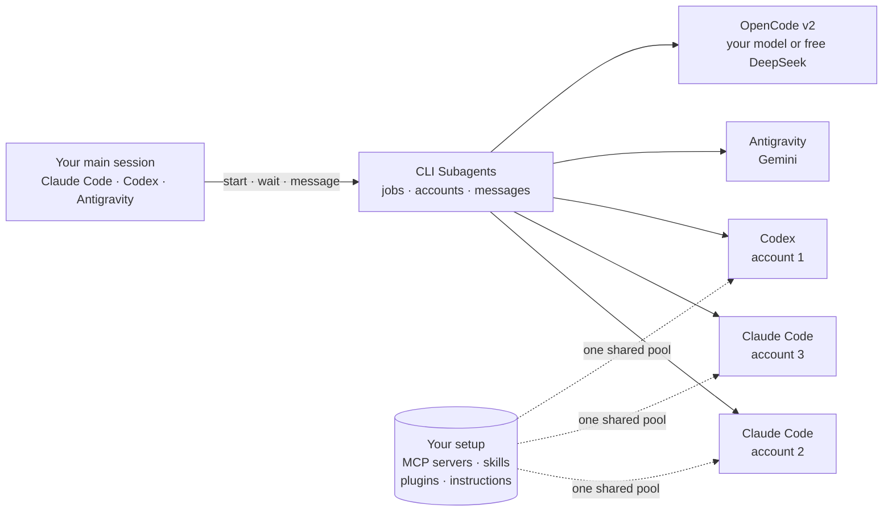

# CLI Subagents

Give your coding agent subagents that run in your other agent CLIs and on your other accounts, all with the same tools.

[](LICENSE)


Your main session, in Claude Code, Codex or Antigravity, can start subagents in Claude Code, Codex, Antigravity or OpenCode. Workers use your existing MCP servers and instructions. Accounts in the same CLI share its skills, plugins and settings too. When a pooled account runs out of quota, the work moves to the next one and carries on. OpenCode uses one profile; its free-model IP limit does not trigger account rotation.

It installs as a plugin in Claude Code, Codex and Antigravity, and works as a plain MCP server in any other MCP client.



## What you get

- Subagents that feel built in. Start one, keep working, and get the result back when it's done. In Claude Code they appear in the agent list like native subagents, colored by CLI and labeled with the model and task, and you can open one to watch each step and its reasoning as the worker goes. `csa setup --host codex` also installs native Codex relay agents, with a separate thread for each job; see [host support](docs/hosts.md#codex) for the app verification still due. Claude Code's hooks also wake an idle session when a subagent finishes or asks a question, and list any uncollected results after you resume.
- Two-way messages. A subagent can send progress notes or ask a question and wait for the answer; you can send it follow-ups while it works, and each message is delivered once.
- One setup for every account. Your MCP servers, skills, plugins, agents, `CLAUDE.md`, project memory and settings are shared from your normal config folder through links and launch flags, not copied. Only the login differs per account.
- Automatic account switching. Claude Code and Codex report each account's 5-hour and weekly usage, and new work goes to the account with the most room. If a Claude, Codex or Gemini account hits its limit mid-task, the job continues on the next account (a Claude conversation moves with its transcript). Failover is on by default and can be turned off per CLI.
- Limits handled for you. Plan presets and extra caps are opt-in. By default, `max_jobs_per_account = 1` runs one worker per account and queues extra jobs. `usage_ceiling = 0.95` blocks new starts on accounts with known usage at or above 95%. Set a plan or extra caps to refuse starts that would go over them, with one line that says what to do instead.
- Only the user can authorize more parallel jobs with `override=<their words>` (relay or MCP) or `--override "..."` (`csa run` / `csa start`). Never set override on your own judgment; use it only when the user asked for more jobs in this conversation, or confirmed after you warned them and told them how much of the 5-hour window is left. It bypasses csa's caps and queueing; real usage-limit cooldowns, model and effort restrictions, login, depth and access still apply. See [configuration](docs/configuration.md#a-user-authorized-override).
- Optional delegation rules. Preview a template with model tiers with `csa rules`, then choose whether to install it. See [Delegation rules](docs/delegation.md).
- Mixing CLIs. A Claude Code session can hand a task to Codex, Gemini (through Antigravity) or OpenCode. The subagent gets the parent's MCP servers and instruction-file paths. OpenCode v2 needs no csa setup: it becomes available when `opencode` is on PATH, unless `[opencode] enabled = false` turns it off. It keeps your OpenCode default model, or uses `opencode/deepseek-v4.1-flash-free` when none is set. Free models are for personal projects only; see [OpenCode](docs/opencode.md).
- Safety checks. `read` jobs get read-only tools. Claude and Codex `edit` jobs use their own review modes. Gemini workers run behind csa's fixed rules plus a separate reviewer model, with Antigravity's sandbox for `edit` jobs. OpenCode `read` and `edit` jobs use csa's fixed rules and have no OS sandbox, so `edit` jobs can change files but can't run tests, builds or other commands that change anything. Skipping permissions is an explicit choice per job.
- Credentials stay with the vendor CLI. Model calls use your own login or provider configuration, including OpenCode's anonymous free models. csa does not copy credentials between runtimes.
- Nothing to install besides Python 3.11. Pure standard library, with its own small MCP server.

## Install

1. Install the `csa` command:

   ```bash
   pipx install git+https://github.com/lunati228/CLI-Subagents
   ```

2. Add the plugin to the CLI you work in:

   | Host | Command |
   |---|---|
   | Claude Code | `/plugin install cli-subagents --marketplace lunati228/CLI-Subagents` in a session, or `claude plugin install cli-subagents --marketplace lunati228/CLI-Subagents` in a terminal |
   | Codex | `csa setup --host codex` installs the plugin and native relay agents |
   | Antigravity | `agy plugin install https://github.com/lunati228/CLI-Subagents` |
   | Any MCP client | Server command `csa` with argument `mcp` |

3. Optional: add your other accounts, each with the CLI's own login.

   ```bash
   csa accounts add max-2
   csa accounts add plus-2 --runtime codex
   csa doctor --live
   ```

`csa setup` can do step 2 for every installed CLI and register account folders that are already logged in; see [For AI agents](#for-ai-agents).

That's it. Ask your main session to use a subagent, or use `/cli-subagents:delegate <task>` in Claude Code. Details per host are in [docs/hosts.md](docs/hosts.md).

## For AI agents

To have your agent (Claude Code, Codex, Antigravity or another) install this for you, paste a prompt like this:

```text
Install CLI Subagents from https://github.com/lunati228/CLI-Subagents. Follow the
"For AI agents" section of its README: install the csa command, run csa setup,
and register my other account folders: <name>=<folder>, <name>=<folder>.
Then tell me exactly what I still have to do myself.
```

If you're the agent, do this. No slash commands are needed.

1. Install the `csa` command and check it with `csa --version`:

   ```bash
   pipx install git+https://github.com/lunati228/CLI-Subagents
   ```

   Without pipx, use `pip install --user git+https://github.com/lunati228/CLI-Subagents` and make sure its scripts folder is on PATH.

2. Run setup. Add one `--account` per extra account folder the user named; folders that are already logged in need no new login:

   ```bash
   csa setup --dry-run --account max-2=~/.claude-2 --account codex:plus-2=~/.codex-2
   csa setup --account max-2=~/.claude-2 --account codex:plus-2=~/.codex-2
   ```

   `csa setup` finds the installed hosts, installs the plugin into each with the host's own terminal commands, registers and syncs the account folders, and ends with a list of what the user still has to do. It skips anything already in place, so running it twice is safe. It never starts a login and never reads credential files. Use `--host claude`, `--host codex` or `--host antigravity` to limit it. The runtime of an account folder is guessed from its contents; a `codex:` or `claude:` prefix sets it.

3. Offer the optional [delegation rules](docs/delegation.md) template. It tells the main agent which models to use per tier, keeps work projects with the home vendor, and sets helper limits. Personal projects can try another CLI first and fall back to the home model when there is no room.

   Ask whether the user wants it and which home and try-first models they want for each tier. If they agree, preview and install with their choices; otherwise skip it. For example:

   ```bash
   csa rules --show --target claude --home-high "Opus 5.5" --try-low "Gemini 3.8 Flash high" --try-medium "Sol 6.1 high"
   csa rules --install --target claude --home-high "Opus 5.5" --try-low "Gemini 3.8 Flash high" --try-medium "Sol 6.1 high"
   ```

   Use the user's models and the host they want. Ask for work folders if the user wants to list them with `--work-folder`. Nothing installs these rules without `--install`.

4. Show the user the "Still needed from you" list from the output. Typical items: browser logins for accounts that aren't logged in (`csa accounts login <name>`), restarting the CLI (or `/reload-plugins` in Claude Code) so the plugin loads, and putting `csa` on PATH.

5. Run `csa doctor --runtime <runtime>` for each runtime you set up (`claude`, `codex`, `antigravity`; no model calls). Plain `csa doctor` checks Claude only. Adding `--live` runs one tiny job per account in that runtime and uses a little quota.

If `csa setup` fails for a host, these are the commands it runs, so you can run them yourself:

| Host | Commands |
|---|---|
| Claude Code | `claude plugin marketplace add lunati228/CLI-Subagents` then `claude plugin install cli-subagents@cli-subagents` |
| Codex | `codex plugin marketplace add lunati228/CLI-Subagents` then `codex plugin add cli-subagents@cli-subagents` |
| Antigravity | `agy plugin install https://github.com/lunati228/CLI-Subagents` |

When the `claude` command can't be found (common with the Claude desktop app) or the plugin commands fail, `csa setup` declares the plugin in Claude Code's `settings.json` instead (`~/.claude/settings.json`, or the one in `$CLAUDE_CONFIG_DIR`). It keeps every other key and saves a backup next to the file. Claude Code installs the plugin on its next start, so the user has to restart it. `csa setup --claude-route settings` takes this route directly. By hand, merge this into the file:

```json
{
  "extraKnownMarketplaces": {
    "cli-subagents": { "source": { "source": "github", "repo": "lunati228/CLI-Subagents" } }
  },
  "enabledPlugins": { "cli-subagents@cli-subagents": true }
}
```

To update later, run `csa update` (`--dry-run` shows the plan first). It reinstalls `csa` from GitHub with the tool that installed it (pipx, uv or pip) and updates the plugin in every host that has it, then lists the restarts. On Windows it prints the package command for you to run instead, because `csa` can't replace itself while running. By hand: `pipx install --force git+https://github.com/lunati228/CLI-Subagents`, then `claude plugin marketplace update cli-subagents` and `claude plugin update cli-subagents@cli-subagents`, `codex plugin marketplace upgrade cli-subagents` and `codex plugin add cli-subagents@cli-subagents`, or `agy plugin install https://github.com/lunati228/CLI-Subagents` again.

To register an account folder by hand: `csa accounts add <name> --home <folder> --no-login`. This defaults to Claude; add `--runtime codex` or `--runtime antigravity` for those accounts. For a new account, omit `--no-login` to open that runtime's login, which the user completes in the browser.

Never read or copy credential files, and never edit files inside `~/.cli-subagents/homes/`; `csa` manages those folders. More for agents working in this repository is in [AGENTS.md](AGENTS.md).

## Status

| Subagent CLI | State | Guide |
|---|---|---|
| Claude Code (`claude -p`) | Works | [Claude Code](docs/claude-code.md) |
| Codex (`codex exec`) | Works | [Codex](docs/codex.md) |
| Antigravity (`agy`, Gemini) | Works; extra accounts at your own risk | [Gemini](docs/gemini.md) |
| OpenCode v2 (`opencode run`) | First version; fake-CLI tests, live verification pending | [OpenCode](docs/opencode.md) |
| Cursor, Gemini CLI, Copilot, others | Researched | [CLI comparison](docs/research/cli-permissions-and-headless.md) |

Tested live on Windows with Claude Code 2.1.299, Codex 0.162.1 and Antigravity 1.4.0; the test suite also runs on macOS and Linux in CI.

## How the shared setup works

Your normal config folder (`~/.claude`, `~/.codex`) is the one pool. Each extra account gets its own folder that holds only its login, state and session history. Before every run CLI Subagents points that folder at the pool:

- folders such as `agents/` and `commands/` become one link to yours, and each skill is linked by name;
- `CLAUDE.md` and `AGENTS.md` are hard links to your files, so it's the same file on disk;
- project memory is linked to your main project memory;
- your settings, MCP servers and plugins are passed to the worker as launch flags (`--settings`, `--mcp-config`, `--plugin-dir`), minus anything that would pick a different login;
- for Codex, your `config.toml` is written into the account folder, which keeps its own trust and notice tables.

OpenCode workers keep your existing OpenCode profile and XDG directories. csa supplies the parent's MCP servers, instruction files, access rules and review plugin through generated config. OpenCode plugins remain OpenCode's own; csa does not translate plugins between CLIs.

Nothing in your own folders is moved or rewritten. One limit: tools built into the Claude desktop app itself (its browser or terminal panes, for example) belong to the app, not to your config, so CLI workers can't have them. Everything in your config folders and plugins is shared. `csa doctor --live` starts a tiny job on each account and compares exactly what each one loaded.

## Using your accounts

All of this runs through each vendor's official CLI with your own login or OpenCode's anonymous free models: the same thing you'd get by opening a terminal and typing the task yourself. Anthropic documents running several accounts side by side with separate config folders, and OpenAI ships its own plugin that runs Codex from Claude Code. Google's Antigravity FAQ rules out wrapping `agy` on consumer plans and automating account rotation, so the Antigravity runtime uses your one signed-in account unless you add more yourself. Extra accounts are marked use at your own risk; once added, they're used the same way as for Claude and Codex, and `failover = "off"` turns switching off. The details and quotes are in [provider terms](docs/research/provider-terms.md); each vendor's terms apply to your accounts. OpenCode's free-model limits and unpaid-content terms are covered in [OpenCode](docs/opencode.md#free-model-limits-and-data-terms).

## Repository layout

```text
src/cli_subagents/      Core: jobs, account pool, shared setup, messages, MCP server, csa CLI
  runtimes/             Claude Code, Codex, Antigravity and OpenCode adapters
  agy_review/           The review gate reused by Antigravity and OpenCode workers
.claude-plugin/         Claude Code and Codex plugin manifest and marketplace
agents/                 Relay agents that show jobs in Claude Code's agent list
src/cli_subagents/templates/codex-agents/   Native Codex relay definitions installed by setup/update
plugin.json, mcp_config.json   Antigravity plugin
skills/cli-subagents/   The skill that teaches the host agent how to use subagents
commands/               /cli-subagents:delegate
tests/                  Unit and end-to-end tests with fake CLIs
adapters/antigravity/   The original standalone AGY server (superseded)
docs/                   Guides, design and research
```

## Documentation

| Document | Contents |
|---|---|
| [Hosts](docs/hosts.md) | Install and use from Claude Code, Codex, Antigravity and other MCP clients |
| [Claude Code](docs/claude-code.md) | Accounts, what is shared, switching, troubleshooting |
| [Codex](docs/codex.md), [Gemini](docs/gemini.md) and [OpenCode](docs/opencode.md) | The other subagent CLIs |
| [Configuration](docs/configuration.md) | `config.toml`, files, environment |
| [Delegation rules](docs/delegation.md) | Optional model tiers, work folders and helper limits |
| [Design](docs/design.md) | Architecture, decisions and what was verified |
| [Research](docs/research/) | CLI comparison, prior art, multi-account tools, provider terms |

## Contributing

Issues and pull requests are welcome. Run the tests before sending a change:

```bash
python -m unittest discover -s tests -t tests
```

Set `PYTHONPATH` to `src` (or install with `pip install -e .`) first. New runtime adapters should keep the vendor's binary unmodified, leave authentication to it, and default to its safer permission mode.

## License and credit

Created by [lunati](https://github.com/lunati228). Licensed under [Apache-2.0](LICENSE). If you redistribute it or build on it, keep the [NOTICE](NOTICE) file. To cite the project, use [CITATION.cff](CITATION.cff).
